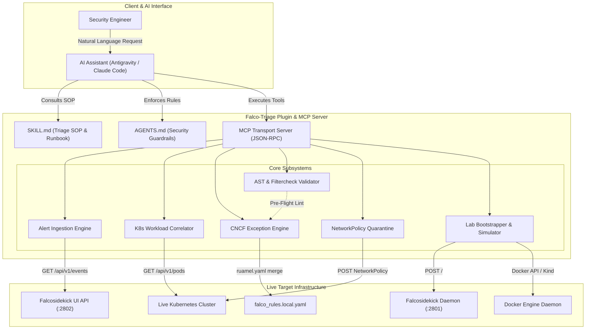
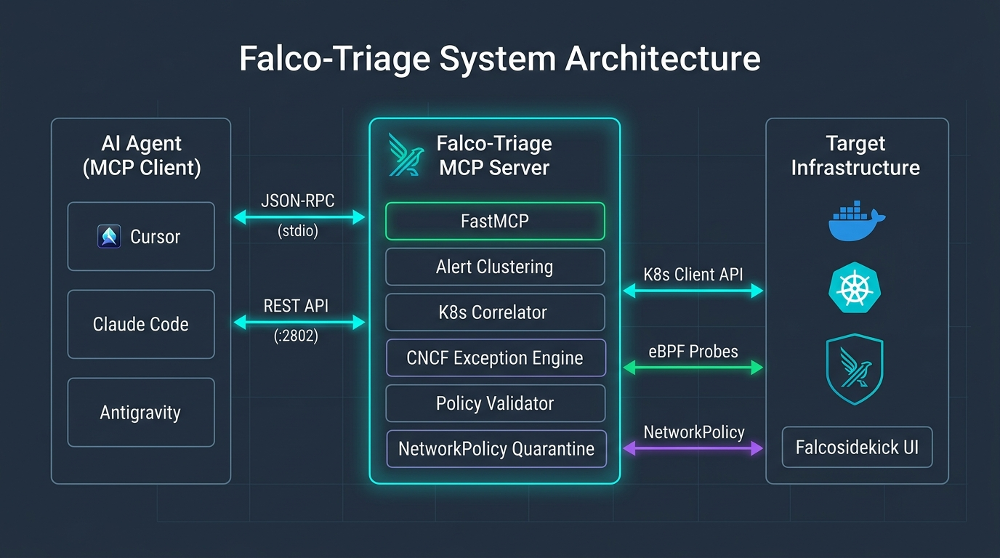

# Falco-Triage - Autonomous Container Security & Falco Rule Tuning Copilot

An intelligent Model Context Protocol (MCP) server and agentic plugin engineered for Container Security Engineers, DevSecOps practitioners, and Kubernetes Platform Operators. It connects AI assistants (Antigravity, Claude Code, Cursor) directly to live runtime alerts and active Kubernetes clusters to eliminate false positives, synthesize CNCF Falco 0.35+ structured exceptions, and quarantine active threats with live runtime verification.

---

 **Full Technical Documentation**: Read the complete [Technical Documentation & Architecture Specification](./docs/TECHNICAL_DOCUMENTATION.md) for in-depth subsystem breakdowns, data contracts, and security specifications.

---

## Key Features

* **Production-Grade Alert Ingestion**: Direct HTTP REST integration with live Falcosidekick daemons (`:2801`) and Falcosidekick UI API (`:2802/api/v1/events/search`), plus native support for local Falco JSON audit logs (`/var/log/falco_events.json`).
* **Multi-Dimensional Noise Clustering**: Groups repetitive alerts across rules, priorities, namespaces, process names, command lines, and container image repositories to identify top sources of alert fatigue.
* **Deep Kubernetes Workload Correlation**: Connects to the active cluster via the official Kubernetes API client (`~/.kube/config`) to inspect live Pod specifications, security contexts (`privileged: true`, capabilities, read-only root filesystems), host mounts (`hostPID`, `hostNetwork`, `hostPath`), and owner controllers.
* **CNCF Falco 0.35+ Structured Exception Engine**: Automatically synthesizes precision, least-privilege exception blocks (`append: true`, `fields`, `comps`, `values`) and safely merges them into existing `falco_rules.local.yaml` files while preserving comments and YAML structure.
* **Pre-Flight AST & Filtercheck Rule Validator**: Validates rules before they hit staging or production, checking syntax, operator compatibility, tuple length alignment, and official Falco filtercheck fields (`proc.*`, `fd.*`, `container.*`, `k8s.*`, `user.*`, `evt.*`) with fuzzy typo suggestions.
* **Active Threat Containment**: Automatically generates locked-down Kubernetes `NetworkPolicy` manifests to quarantine actively compromised pods (dropping all ingress and egress except DNS) while preserving in-memory forensics.
* **Two Dedicated Operational Paths**:
  * **Path 1 (Live Cluster Triage)**: Triage active clusters, tune noisy production rules, and quarantine live pods.
  * **Path 2 (Zero-to-One Sandbox Bootstrap)**: Spin up fresh Kind clusters, deploy Falcosidekick, and dispatch realistic alert simulations with pure natural language.
* **Universal Plugin Packaging**: Operates as both a standalone MCP server and a full Antigravity / Claude Code plugin bundling runbooks (`SKILL.md`) and hard security guardrails (`rules/AGENTS.md`).

---

## System Architecture



<p align="center">
  
</p>
<p align="center"><b>Figure 1: Falco-Triage End-to-End System Architecture</b></p>

### Flow-by-Flow Explanation of the Architecture

1. **User Request & Agent Consultation**:  
   The Security Engineer enters a natural language prompt into their AI assistant (e.g. *"Triage the top alerts in our monitoring namespace and tune them"*). The AI assistant first inspects `SKILL.md` for standard operating procedures and verifies strict guardrails in `rules/AGENTS.md` (e.g. never blanket-suppress high-severity alerts).
2. **Tool Dispatch via MCP Server**:  
   The AI assistant routes requests through the MCP Transport Server using typed JSON-RPC standard input/output (`stdio`).
3. **Alert Ingestion**:  
   The **Alert Ingestion Engine** queries the live Falcosidekick UI API (`/api/v1/events/search`) or local JSON logs, parses the raw `output_fields`, and clusters alerts by rule and frequency.
4. **Workload Context Correlation**:  
   The **K8s Workload Correlator** takes the pod name and namespace from the alert and contacts the active Kubernetes API server (`~/.kube/config`). It retrieves the pod specification, owner controllers (e.g. DaemonSet), privileges, capabilities, and volume mounts.
5. **Assessment & Exception Synthesis**:  
   If the alert is confirmed to be an authorized infrastructure daemon (e.g. `node-exporter` writing to `/etc/resolv.conf`), the **CNCF Exception Engine** generates a least-privilege exception block scoped by namespace, process name, image repository, and file path.
6. **Pre-Flight Validation**:  
   The **AST & Filtercheck Validator** lints the generated YAML against Falco's filtercheck dictionary, verifying syntax, comparison operators, and tuple dimensions before anything is committed to disk.
7. **Rule Patching & Quarantine**:  
   The exception is cleanly merged into `falco_rules.local.yaml` using `ruamel.yaml` without damaging existing comments. Alternatively, if malicious activity is identified, the **NetworkPolicy Quarantine** generator synthesizes an immediate ingress/egress isolation manifest.
8. **Lab Bootstrapping & Dispatch**:  
   For testing sandboxes, the **Lab Bootstrapper** controls Docker Engine and Kind to spin up fresh clusters, deploy Falcosidekick, and dispatch realistic alert payloads to the live daemon.

---

## Tech Stack

| Layer | Technologies | Purpose |
| :--- | :--- | :--- |
| **Protocol & Agent** | Model Context Protocol (`mcp 2.3.0`), Python 3.10+ | High-performance JSON-RPC tool and prompt routing |
| **Runtime Client** | `httpx 0.28+`, `asyncio` | Asynchronous communication with Falcosidekick REST endpoints |
| **Kubernetes API** | `kubernetes 37.0+` (Official Client) | Cluster authentication, Pod inspection, NetworkPolicy generation |
| **YAML & AST Engine** | `ruamel.yaml 0.19+` | Comment-preserving, schema-accurate Falco YAML generation |
| **Data Validation** | `pydantic 2.13+` | Strict schema validation and data serialization |
| **Package Management** | `uv 0.5+`, `hatchling` | Ultra-fast virtualenv creation and deterministic dependency resolution |
| **Testing & CI** | `pytest 9.1+`, `pytest-asyncio 1.4+` | Full test suite covering 16 unit, schema, and integration tests |
| **Target Runtime** | Docker Engine, Kind (Kubernetes-in-Docker), Falco, Falcosidekick | Live container security infrastructure |

---

## Detailed Setup Instructions

Follow these step-by-step instructions. Copy-and-paste commands are provided for every operating system and AI client.

---

### Step 1: Infrastructure Setup (If You Do Not Have Docker or Kubernetes Yet)

If you already have Docker and Kubernetes installed and running, you can skip to [Step 2](#step-2-install-falco-triage). 

If you do **not** have Docker, Kubernetes, or the `kind` CLI installed, run the commands for your operating system below:

#### Option A: Windows (PowerShell as Administrator or User)
```powershell
# 1. Install uv (Python package manager)
winget install astral-sh.uv --silent --accept-package-agreements --accept-source-agreements

# 2. Install Docker Desktop
winget install Docker.DockerDesktop --silent --accept-package-agreements --accept-source-agreements

# 3. Install Kubernetes CLI (kubectl)
winget install Kubernetes.kubectl --silent --accept-package-agreements --accept-source-agreements

# 4. Install Kind (Kubernetes-in-Docker)
winget install Kubernetes.kind --silent --accept-package-agreements --accept-source-agreements

# 5. Install Helm (optional)
winget install Helm.Helm --silent --accept-package-agreements --accept-source-agreements
```
> *After installing Docker Desktop on Windows, start **Docker Desktop** from the Start Menu once to initialize the engine.*

#### Option B: macOS (Terminal via Homebrew)
```bash
# 1. Install Homebrew (if not already installed)
/bin/bash -c "$(curl -fsSL https://raw.githubusercontent.com/Homebrew/install/HEAD/install.sh)"

# 2. Install uv and Docker Desktop
brew install uv
brew install --cask docker

# 3. Install Kubernetes CLI (kubectl) and Kind
brew install kubectl kind helm
```
> *After installation, open **Docker Desktop** from your Applications folder to initialize the daemon.*

#### Option C: Linux (Ubuntu / Debian / WSL2)
```bash
# 1. Install uv
curl -LsSf https://astral.sh/uv/install.sh | sh
source $HOME/.local/bin/env

# 2. Install Docker Engine
curl -fsSL https://get.docker.com -o get-docker.sh
sudo sh get-docker.sh
sudo usermod -aG docker $USER
# Activate group changes
newgrp docker

# 3. Install kubectl
curl -LO "https://dl.k8s.io/release/$(curl -L -s https://dl.k8s.io/release/stable.txt)/bin/linux/amd64/kubectl"
sudo install -o root -g root -m 0755 kubectl /usr/local/bin/kubectl
rm kubectl

# 4. Install Kind
curl -Lo ./kind https://kind.sigs.k8s.io/dl/v0.27.0/kind-linux-amd64
chmod +x ./kind
sudo mv ./kind /usr/local/bin/kind
```

#### Quick Verification Check
Run this single verification line to confirm your toolchain is operational:
```bash
docker --version && kubectl version --client && kind version && uv --version
```

---

---

### Step 1.1: Installing Falco (Required Pre-Requisite)

> [!IMPORTANT]
> **Falco is a mandatory prerequisite** for live runtime threat monitoring.  
> Falco uses an eBPF driver to monitor Linux kernel system calls in real-time. Follow the baby-step guide below matching your environment:

#### Option A: Installing Falco into Kubernetes / Kind (Recommended)
Follow these 4 baby steps:

**Step 1: Add the Falcosecurity Helm repository**
```bash
helm repo add falcosecurity https://falcosecurity.github.io/charts
helm repo update
```

**Step 2: Verify your Kubernetes cluster node is reachable**
```bash
kubectl get nodes
```

**Step 3: Deploy Falco with modern eBPF probe and Falcosidekick UI**
```bash
helm install falco falcosecurity/falco \
  --namespace falco \
  --create-namespace \
  --set driver.kind=modern_ebpf \
  --set falcosidekick.enabled=true \
  --set falcosidekick.webui.enabled=true
```

**Step 4: Verify the Falco DaemonSet is running**
```bash
kubectl get pods -n falco -o wide
```
*(You should see `falco-*`, `falco-falcosidekick-*`, and `falco-falcosidekick-ui-*` in `Running` state).*

**Step 5: Access the Web UI (Port-Forward)**
```bash
kubectl port-forward -n falco svc/falco-falcosidekick-ui 2802:2802
```
Now visit [http://localhost:2802](http://localhost:2802) in your browser.

---

#### Option B: Installing Falco directly on Linux (Ubuntu / Debian / WSL2)
Follow these baby steps to install the official Falco service:

**Step 1: Install trust key and official repository**
```bash
curl -fsSL https://falco.org/repo/falcosecurity-packages.asc | sudo gpg --dearmor -o /usr/share/keyrings/falco-archive-keyring.gpg
echo "deb [signed-by=/usr/share/keyrings/falco-archive-keyring.gpg] https://download.falco.org/packages/deb stable main" | sudo tee /etc/apt/sources.list.d/falcosecurity.list
sudo apt-get update
```

**Step 2: Install linux headers matching your active kernel**
```bash
sudo apt-get install -y linux-headers-$(uname -r)
```

**Step 3: Install the Falco package**
```bash
sudo apt-get install -y falco
```

**Step 4: Choose modern-ebpf driver during setup or configure `/etc/falco/falco.yaml`**
```bash
sudo systemctl enable --now falco
sudo systemctl status falco
```

**Step 5: Verify Falco is processing system calls**
```bash
sudo journalctl -u falco -n 20 --no-pager
```

---

#### Option C: Running Falco as a Standalone Docker Container (Linux Host)
If running on a Linux Docker host:
```bash
docker run -d --name falco \
  --privileged \
  -v /var/run/docker.sock:/host/var/run/docker.sock \
  -v /dev:/host/dev \
  -v /proc:/host/proc:ro \
  -v /boot:/host/boot:ro \
  -v /lib/modules:/host/lib/modules:ro \
  -v /usr:/host/usr:ro \
  -v /etc:/host/etc:ro \
  falcosecurity/falco:latest
```

---

#### How Falco-Triage Connects to Your Falco Installation
Once Falco is installed per above:
1. **Live Falcosidekick API**: Connects to port `2802` (`http://localhost:2802/api/v1/events/search`).
2. **Local Falco Event Logs**: If running as a standalone service, Falco outputs JSON logs to `/var/log/falco_events.json`. Falco-Triage can ingest them directly using `ingest_falco_alerts(source="file", file_path="/var/log/falco_events.json")`.
3. **Local Testing/Sandbox Note**: For Windows/macOS laptops where Linux eBPF drivers cannot attach to the host kernel directly, you can run Falco in a local Kind/Minikube Linux VM, or use `bootstrap_falcosidekick_lab` + `dispatch_test_falco_alert` to simulate real Falco event flows without kernel privileges.

---

### Step 2: Install Falco-Triage

Clone the repository and set up the local virtual environment:

```bash
# 1. Clone the repository
git clone https://github.com/ritvikindupuri/FalcoMCP.git
cd FalcoMCP

# 2. Create an isolated virtual environment with uv
uv venv

# 3. Install the application and all dependencies in editable mode
uv pip install -e ".[dev]"
```

> [!TIP]
> **Directory Path Note**: If you cloned to a different path (e.g. `C:\Users\username\FalcoMCP` or `/home/user/FalcoMCP`), use that directory in the client configuration commands in [Step 4](#step-4-connect-falco-triage-to-your-ai-assistant-all-major-clients) below.

---

### Step 3: Run Pre-Flight Tests

Verify that all 16 unit and integration tests pass cleanly:
```bash
uv run pytest -v
```
You should see:
```text
============================= 16 passed in 14.05s =============================
```

---

### Step 4: Connect Falco-Triage to Your AI Assistant (All Major Clients)

Pick your AI client below and follow the copy-and-paste configuration:

#### 1. Cursor
You can configure Falco-Triage in Cursor via either the UI or a project file:

* **Method A: Project Configuration File (Recommended)**  
  Create or update `.cursor/mcp.json` in your workspace:
  ```json
  {
    "mcpServers": {
      "falco-triage": {
        "command": "uv",
        "args": [
          "--directory",
          "C:\\Users\\ritvi\\.gemini\\antigravity\\scratch\\falco-triage-mcp",
          "run",
          "falco-triage"
        ]
      }
    }
  }
  ```
  *(On macOS/Linux, change the directory to your absolute path, e.g. `/home/user/falco-triage-mcp`)*

* **Method B: Cursor Settings UI**  
  1. Open Cursor and navigate to **Cursor Settings (`Ctrl+,` or `Cmd+,`) > Features > MCP**.
  2. Click **+ Add New MCP Server**.
  3. Enter:
     * **Name**: `falco-triage`
     * **Type**: `command`
     * **Command**: `uv --directory "C:\Users\ritvi\.gemini\antigravity\scratch\falco-triage-mcp" run falco-triage`
  4. Click **Save**. The status indicator will turn green.

---

#### 2. Claude Code (CLI `claude`)
If you use Anthropic's **Claude Code** terminal CLI:

```bash
# Run this command in your terminal
claude mcp add falco-triage uv -- --directory "C:\Users\ritvi\.gemini\antigravity\scratch\falco-triage-mcp" run falco-triage
```

Or add it directly to your `~/.claude.json` configuration file:
```json
{
  "mcpServers": {
    "falco-triage": {
      "command": "uv",
      "args": [
        "--directory",
        "C:\\Users\\ritvi\\.gemini\\antigravity\\scratch\\falco-triage-mcp",
        "run",
        "falco-triage"
      ]
    }
  }
}
```

---

#### 3. Claude Desktop
Add `falco-triage` to your `claude_desktop_config.json`:
* **Windows**: `%APPDATA%\Claude\claude_desktop_config.json`
* **macOS**: `~/Library/Application Support/Claude/claude_desktop_config.json`

```json
{
  "mcpServers": {
    "falco-triage": {
      "command": "uv",
      "args": [
        "--directory",
        "C:\\Users\\ritvi\\.gemini\\antigravity\\scratch\\falco-triage-mcp",
        "run",
        "falco-triage"
      ]
    }
  }
}
```
> *Restart Claude Desktop after editing.*

---

#### 4. Google Antigravity & Gemini CLI
Add `falco-triage` to your global `~/.gemini/config/mcp_config.json`:
* **Windows**: `C:\Users\<username>\.gemini\config\mcp_config.json`
* **Linux/macOS**: `~/.gemini/config/mcp_config.json`

```json
{
  "mcpServers": {
    "falco-triage": {
      "command": "C:\\Users\\ritvi\\.gemini\\antigravity\\scratch\\falco-triage-mcp\\.venv\\Scripts\\python.exe",
      "args": [
        "-m",
        "falco_triage.server"
      ],
      "env": {
        "PYTHONPATH": "C:\\Users\\ritvi\\.gemini\\antigravity\\scratch\\falco-triage-mcp\\src"
      }
    }
  }
}
```
> *To enable the companion skills and rules, copy the `falco-triage` folder into `~/.gemini/config/plugins/falco-triage/`.*

---

#### 5. Windsurf (Codeium)
Add `falco-triage` to your Windsurf MCP configuration file at `~/.codeium/windsurf/mcp_config.json`:

```json
{
  "mcpServers": {
    "falco-triage": {
      "command": "uv",
      "args": [
        "--directory",
        "C:\\Users\\ritvi\\.gemini\\antigravity\\scratch\\falco-triage-mcp",
        "run",
        "falco-triage"
      ]
    }
  }
}
```

---

#### 6. VS Code Extensions (Cline / Roo Code / Continue)
For **Cline** or **Roo Code**:
1. Open the **Cline/Roo Code** panel in VS Code.
2. Click the **MCP Servers** icon (plug icon).
3. Click **Configure MCP Servers** (or edit `cline_mcp_settings.json`):
```json
{
  "mcpServers": {
    "falco-triage": {
      "command": "uv",
      "args": [
        "--directory",
        "C:\\Users\\ritvi\\.gemini\\antigravity\\scratch\\falco-triage-mcp",
        "run",
        "falco-triage"
      ]
    }
  }
}
```

---

#### 7. OpenAI Codex & Custom Agent Runtimes
For custom agents using Python or Node.js to spawn MCP processes over stdio:
* **Executable**: `uv`
* **Invocation Arguments**: `["--directory", "/path/to/falco-triage-mcp", "run", "falco-triage"]`
* **Direct Python Binary Alternative**:
  * Command: `/path/to/falco-triage-mcp/.venv/bin/python` (or `.venv\Scripts\python.exe` on Windows)
  * Args: `["-m", "falco_triage.server"]`
  * Environment: `{"PYTHONPATH": "/path/to/falco-triage-mcp/src"}`

---


## How to Use the Plugin (Detailed Step-by-Step Guide)

Falco-Triage is designed so that **no user is ever confused**, regardless of whether you have an enterprise production cluster or are sitting at a laptop with zero infrastructure. 

---

### Quick-Action Prompts (One-Click Copy & Paste)

The moment you ask your assistant *"What is the Falco MCP server and what tools do you have access to?"*, you can immediately launch any of these quick-action prompts:

| Goal / Scenario | Quick-Action Prompt to Copy & Paste | Operational Path |
| :--- | :--- | :--- |
| **Server & Tools Discovery** | `"What is the Falco MCP server and what tools do you have access to?"` | Discovery |
| **Real Test Data with Docker, Falco & K8s** | `"I have Docker, Kubernetes, and Falco installed per the setup guide. Please inspect my cluster, spin up sample Nginx and node-exporter workloads, deploy the Falcosidekick UI forwarder, and dispatch test alerts so I can test rule tuning."` | Path 2 (Testing) |
| **Live Noise Reduction & Clustering** | `"Run ingest_falco_alerts to pull recent alerts from our Falcosidekick deployment at http://localhost:2802, cluster them by rule, and show me the top false positives."` | Path 1 (Production) |
| **Precision Rule Tuning** | `"We are getting hundreds of alerts from '<Rule Name>' on <pod-name> in namespace <namespace>. Correlate the pod and generate a least-privilege Falco structured exception."` | Path 1 (Production) |
| **Immediate Threat Quarantine** | `"Investigate pod <pod-name> in namespace <namespace> using correlate_k8s_workload. If an unexpected interactive shell spawned, generate a zero-trust NetworkPolicy to isolate it immediately."` | Path 1 (Containment) |
| **Docker-Only Lightweight Lab** | `"Launch a fresh Falcosidekick testing lab in Docker using bootstrap_falcosidekick_lab and send a test shell_in_container alert."` | Path 2 (Containers) |
| **Offline Rule Linting & Exception Synthesis** | `"Validate this Falco rule YAML and tell me if the filtercheck fields, operators, and tuple structures conform to CNCF Falco 0.35+ specs."` | Path 1 & 2 (Offline) |

---

### Scenario A: You Already Have Everything Running (Falco, K8s, Falcosidekick)
*Use this in active staging or production environments to eliminate false positives and triage incidents.*

#### Step 1: Ingest Live Production Alerts
In your AI chat (Cursor, Claude Code, Antigravity), type:
> *"Run `ingest_falco_alerts` to pull recent alerts from our Falcosidekick deployment at `http://localhost:2802` and show me the noisiest rules."*

* **What happens**: The agent queries `/api/v1/events/search`, clusters repetitive events by signature, and shows a ranked breakdown of noisy rules, affected namespaces, pods, and command lines.

#### Step 2: Correlate with Live Pod Metadata
Pick a noisy rule (e.g. `Write below etc` on pod `node-exporter-4k2ln`) and type:
> *"Inspect the pod `node-exporter-4k2ln` in namespace `monitoring` using `correlate_k8s_workload`."*

* **What happens**: The agent connects to your active cluster via `~/.kube/config`, inspects the pod's `securityContext` (`privileged`, capabilities, host mounts), and confirms whether it is an authorized DaemonSet.

#### Step 3: Synthesize Least-Privilege Exception
Type:
> *"Generate a least-privilege Falco structured exception for this `Write below etc` cluster."*

* **What happens**: The agent calls `generate_falco_exception(strategy="least_privilege")` to generate CNCF Falco 0.35+ YAML scoped by namespace (`monitoring`), process (`node-exporter`), image (`prom/node-exporter`), and file path prefix (`/etc/resolv.conf`).

#### Step 4: Validate and Append to Rules File
Type:
> *"Validate the exception with `validate_falco_rule` and append it to `falco_rules.local.yaml`."*

* **What happens**: The agent checks filtercheck field names, operators, and tuple dimensions, then cleanly merges the exception into your local rules file without overwriting existing configurations.

#### Step 5: Active Containment (If Rogue Activity Detected)
If an alert indicates an unauthorized interactive shell (e.g. bash spawned in an external Nginx container), type:
> *"Isolate the pod `web-frontend-x9zlq` in namespace `default` using `generate_pod_isolation_policy`."*

* **What happens**: The agent produces a production `NetworkPolicy` manifest that drops all ingress and egress (except DNS) and provides the copy-and-paste `kubectl apply` command.

---

### Scenario B: You Have Falco, Docker, and Kubernetes Installed, but Need Sample Workloads & Alerts to Test ?
*Use this if you installed Falco per [Step 1.1](#step-11-installing-falco-required-pre-requisite) and want to spin up test pods and simulate realistic runtime threats.*

#### The One-Shot Prompt:
Simply copy and paste this prompt into your AI chat:
> *"I have Docker, Kubernetes, and Falco installed per the setup guide. Please inspect my cluster, spin up sample Nginx and node-exporter workloads, deploy the Falcosidekick UI forwarder, and dispatch test alerts so I can test rule tuning."*

*(Or trigger the pre-configured prompt: `spin_up_sample_cluster_and_workloads`)*

#### What the Plugin Autonomously Executes:
1. **Cluster Inspection (`check_lab_environment`)**: The agent tests your active Kubernetes cluster connectivity.
2. **Falcosidekick Deployment (`deploy_falcosidekick_to_kubernetes`)**:
   * Deploys official Falcosidekick and Falcosidekick UI forwarders directly into the `falco` namespace if not already present.
3. **Sample Test Pod Provisioning (`deploy_sample_k8s_workloads`)**: Deploys realistic sample workloads to test against:
   * `default/web-frontend`: Nginx web server deployment.
   * `monitoring/node-exporter`: Prometheus node-exporter deployment.
4. **High-Fidelity Alert Simulation (`dispatch_test_falco_alert`)**: Injects real CNCF Falco runtime security alerts targeting those exact pods:
   * A `Write below etc` alert originating from `node-exporter` writing to `/etc/resolv.conf`.
   * A `Terminal shell in container` alert originating from `bash` inside `web-frontend`.
5. **Live Triage Walkthrough**: The alert appears in the UI (`http://localhost:2802`). The agent queries it back with `ingest_falco_alerts`, inspects the sample pod with `correlate_k8s_workload`, and guides you through tuning your first exception!

---

### Scenario C: You Only Have Docker (Lightweight Container Sandbox)
*Use this if you don't want a Kubernetes cluster and just want a quick, lightweight containerized sandbox.*

#### Step 1: Launch Containers
Type:
> *"Launch a fresh Falcosidekick testing lab in Docker using `bootstrap_falcosidekick_lab`."*

* **What happens**: 
  1. The agent checks Docker. If Docker Desktop is stopped, it starts it.
  2. Creates a dedicated bridge network (`falco-lab-net`).
  3. Launches official `falcosecurity/falcosidekick` (port 2801) and `falcosecurity/falcosidekick-ui` (port 2802) containers.

#### Step 2: Dispatch Real Alert Payloads
Type:
> *"Send a test `shell_in_container` alert to the daemon."*

* **What happens**: The agent dispatches a real alert payload to `POST http://localhost:2801/`. The alert is viewable at `http://localhost:2802`.

#### Step 3: Triage and Tune
Type:
> *"Ingest the alert from the UI and write a least-privilege exception for it."*

* **What happens**: The agent queries the UI, extracts the process and image, and outputs a validated Falco structured exception.

---

### Scenario D: You Have ZERO Infrastructure Running (Offline "Paste & Tune")
*Use this if you are completely offline, sitting at a laptop without Docker or Kubernetes, and just want to write safe Falco exceptions or lint rules.*

#### 1. Paste & Tune an Alert from Slack / Datadog
Type:
> *"Here is an alert firing in production: `node-exporter opened /etc/resolv.conf for writing in namespace monitoring`. Write a least-privilege exception for it."*

* **What happens**: The agent invokes `generate_falco_exception` and returns valid CNCF Falco 0.35+ YAML—**with zero running cluster required**.

#### 2. Pre-Flight Linter & Typo Checker
Type:
> *"Check this custom Falco rule for syntax errors or typos: `- rule: Test; append: true; exceptions: [{name: test, fields: [proc.nme], comps: [=], values: [bash]}]`"*

* **What happens**: The agent runs `validate_falco_rule`, catches the typo (`proc.nme`), and suggests the correct field (`proc.name`).

#### 3. Offline JSON Audit File Analysis
Type:
> *"Analyze this historical Falco audit log file `C:\logs\falco_events.json` and show me the top noisy rules."*

* **What happens**: The agent calls `ingest_falco_alerts(source="file", file_path="...")` and aggregates all false-positive clusters offline.

---
## Testing & Quality Assurance

The test suite includes 16 automated tests covering:
* **Exception Engine**: Multi-field tuple generation, single-field scoping, least-privilege strategies, and comment-preserving YAML merging.
* **AST Validator**: Filtercheck dictionary checks, fuzzy typo detection (`proc.cmdlie` $\rightarrow$ `proc.cmdline`), and operator dimension alignment.
* **Alert Ingestion**: JSON log parsing, multi-cluster frequency calculations, and live API queries.
* **Kubernetes Client**: Dynamic NetworkPolicy generation and graceful offline fallbacks.
* **Integration**: End-to-end execution of all 10 MCP tools and 4 prompts.

Run the tests anytime:
```bash
uv run pytest -v
```

---

## License

This project is licensed under the Apache 2.0 License. Conforms to CNCF Falco specifications.


