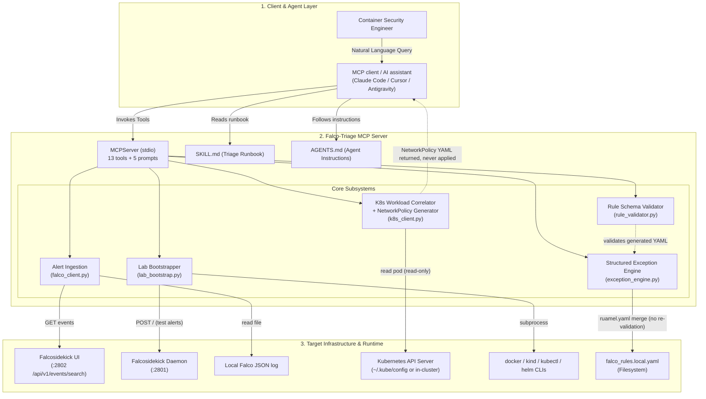
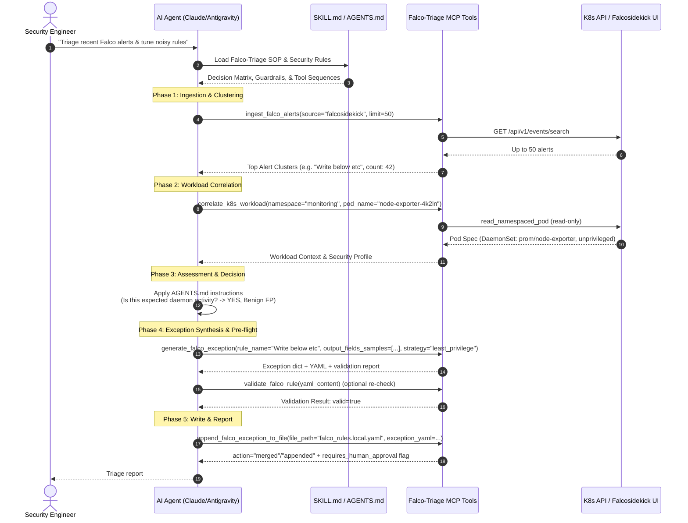

# Falco-Triage: Container Security & Rule Tuning Copilot
### Technical Documentation & Architectural Specification

**By: Ritvik Indupuri**  
**Date: October 7, 2026**

---

## Table of Contents
1. [Executive Summary](#1-executive-summary)
2. [System Architecture](#2-system-architecture)
   - [System Architecture Diagram](#system-architecture-diagram)
   - [Component Specifications](#component-specifications)
3. [Agent Architecture](#3-agent-architecture)
   - [Agent Lifecycle Diagram](#agent-lifecycle-diagram)
   - [Agent Reasoning & Guardrails](#agent-reasoning--guardrails)
4. [Core Features & Technical Subsystems](#4-core-features--technical-subsystems)
   - [4.1 Dual-Path Operational Model](#41-dual-path-operational-model)
   - [4.2 Live Alert Ingestion & Noise Clustering Engine](#42-live-alert-ingestion--noise-clustering-engine)
   - [4.3 Kubernetes Workload Context Correlation](#43-kubernetes-workload-context-correlation)
   - [4.4 CNCF Falco 0.35+ Structured Exception Engine](#44-cncf-falco-035-structured-exception-engine)
   - [4.5 Pre-Flight Schema & Filtercheck Rule Validator](#45-pre-flight-schema--filtercheck-rule-validator)
   - [4.6 Quarantine NetworkPolicy Generator (YAML Only)](#46-quarantine-networkpolicy-generator-yaml-only)
   - [4.7 Automated Lab Bootstrapper & Alert Simulator](#47-automated-lab-bootstrapper--alert-simulator)
5. [Comprehensive Setup & Client Integration Matrix](#5-comprehensive-setup--client-integration-matrix)
   - [5.1 Infrastructure Bootstrapping (Docker & Kubernetes)](#51-infrastructure-bootstrapping-docker--kubernetes)
   - [5.2 Application Installation](#52-application-installation)
   - [5.3 AI Client Configuration Matrix (Cursor, Claude Code, Codex, Antigravity, Windsurf, Cline)](#53-ai-client-configuration-matrix)
6. [Data Contracts & Schema Specifications](#6-data-contracts--schema-specifications)
7. [Security Guardrails & Compliance](#7-security-guardrails--compliance)
8. [Verification & Test Matrix](#8-verification--test-matrix)
9. [Conclusion](#9-conclusion)

---

## 1. Executive Summary

In containerized cloud-native environments, **Falco** is the de facto CNCF standard for runtime threat detection, capturing Linux system calls and Kubernetes audit events. However, the operational adoption of Falco across enterprise Kubernetes fleets is chronically bottlenecked by **alert fatigue** and **false-positive rule tuning overhead**. Default Falco rules trigger thousands of alerts daily due to legitimate infrastructure tasks performed by system daemons, CI/CD runners, storage operators, and monitoring agents (such as Prometheus `node-exporter` or `datadog-agent`). 

Tuning Falco rules safely requires authoring complex YAML overrides using CNCF Falco 0.35+ structured exceptions (`append: true`, `fields`, `comps`, `values`). A single syntax error or typo in filtercheck field names (e.g. typing `proc.nme` instead of `proc.name`) can crash the Falco daemon (`CrashLoopBackOff`), while overly broad exceptions create massive security blind spots.

**Falco-Triage** bridges this gap. It is a **Model Context Protocol (MCP)** server (stdio) with companion plugin assets (`plugin.json`, `skills/falco-triage/SKILL.md`, `rules/AGENTS.md`). It reads alerts from live Falcosidekick UI HTTP endpoints or local Falco JSON logs, reads Pod data from the Kubernetes API (read-only), and writes exceptions to local Falco rules files. Lab test alerts are fixed sample payloads (`REAL_FALCO_EVENT_TEMPLATES` in `lab_bootstrap.py`). It enables security engineers to either triage live production clusters (Path 1) or bootstrap complete isolated testing sandboxes from scratch using natural language (Path 2).

---

## 2. System Architecture

The Falco-Triage platform operates as a multi-tier, decoupled architecture interfacing between the AI Assistant (Antigravity, Claude Code, Cursor), live infrastructure components (Kubernetes API, Docker Engine), and Falco runtime endpoints.

### System Architecture Diagram



<p align="center"><b>Figure 1: Falco-Triage End-to-End System Architecture</b></p>

### Component Specifications

1. **Transport Dispatcher (`src/falco_triage/server.py`)**:
   Built on the Python MCP SDK (`mcp>=1.0.0` declared, 2.3.0 locked in `uv.lock`) using `mcp.server.mcpserver.MCPServer`. It exposes 13 tools and 5 prompts over stdio (`app.run(transport="stdio")`).
   * **Tools (13)**: `check_lab_environment`, `bootstrap_falcosidekick_lab`, `bootstrap_kind_cluster`, `deploy_falcosidekick_to_kubernetes`, `deploy_sample_k8s_workloads`, `install_falco_to_kubernetes`, `dispatch_test_falco_alert`, `ingest_falco_alerts`, `correlate_k8s_workload`, `generate_falco_exception`, `append_falco_exception_to_file`, `validate_falco_rule`, `generate_pod_isolation_policy`.
   * **Prompts (5)**: `path1_live_cluster_triage`, `path2_bootstrap_sandbox_lab`, `spin_up_sample_cluster_and_workloads`, `tune_noisy_rule`, `isolate_compromised_pod`.
   * **Input hardening**: URL parameters must use `http`/`https` with a host; file paths are restricted by extension (`.yaml`/`.yml`/`.json` for rules files, `.json`/`.jsonl`/`.log`/`.txt` for logs). There is no directory allow-list.

2. **Alert Ingestion Engine (`src/falco_triage/falco_client.py`)**:
   Uses asynchronous HTTP (`httpx`) against the Falcosidekick UI API (`/api/v1/events/search`, falling back to `/api/v1/events` on 404), or reads a local line-delimited JSON file (each line an event object or an array of events; unparsable lines are skipped). Groups events by `(rule, priority)` and collects the namespaces, pods, processes, and image repositories seen in each group. The Falcosidekick daemon (`:2801`) is only used for `/healthz` checks and lab test-alert POSTs.

3. **Kubernetes Workload Correlator (`src/falco_triage/k8s_client.py`)**:
   Uses the official Kubernetes Python client, authenticating via `~/.kube/config` (optional path and context) or in-cluster config when `KUBERNETES_SERVICE_HOST` is set. Read-only: it calls `read_namespaced_pod` (plus version/node listing for connectivity checks). Returns container images, commands/args, security contexts (`privileged`, `allow_privilege_escalation`, `read_only_root_filesystem`, `run_as_user`, `run_as_non_root`, capabilities), host namespace flags (`host_network`, `host_pid`, `host_ipc`), `hostPath` volumes, labels, direct owner references, phase, and pod IP.

4. **CNCF Falco Exception Engine (`src/falco_triage/exception_engine.py`)**:
   Synthesizes structured exceptions (`append: true`, `fields`, `comps`, `values`) from alert `output_fields`. Merges into an existing rules file via a `ruamel.yaml` round-trip load/dump: an exception with the same rule and name has new value rows appended; otherwise the exception or rule is added. Comments generally survive the round trip, but formatting may be normalized (comment preservation is not covered by tests).

5. **Rule Schema & Filtercheck Validator (`src/falco_triage/rule_validator.py`)**:
   Parses YAML with `ruamel.yaml` and checks field names against a built-in list of 62 common filtercheck fields (`proc.*`, `fd.*`, `container.*`, `k8s.*`, `user.*`, `group.*`, `evt.*`), comparison operators, `fields`/`comps` length, and `values` row arity. It is not an AST parser and does not parse `condition` expressions.

6. **NetworkPolicy Quarantine Generator (`src/falco_triage/k8s_client.py`)**:
   Builds a `networking.k8s.io/v1` `NetworkPolicy` that denies all ingress and all egress except DNS (port 53 UDP/TCP to `kube-dns`/`coredns` pods). It returns the manifest, YAML (rendered with PyYAML), and a `kubectl apply` command; it never applies anything to the cluster.

7. **Lab Bootstrapper & Simulator (`src/falco_triage/lab_bootstrap.py`)**:
   Runs `docker`, `kind`, `kubectl`, and `helm` as subprocesses: launches Docker Desktop (Windows default install path only), runs `falcosecurity/falcosidekick` and `falcosecurity/falcosidekick-ui` containers on the `falco-lab-net` Docker network, creates Kind clusters, applies Falcosidekick and sample-workload manifests with `kubectl apply`, installs Falco with Helm, and POSTs sample Falco events to the Falcosidekick daemon.

---

## 3. Agent Architecture

Falco-Triage is designed to be driven by an AI agent. The decision-making happens in the MCP client: `rules/AGENTS.md` (agent instructions) and `skills/falco-triage/SKILL.md` (runbook) guide the model through investigation, threat determination, and remediation. The server itself only executes the tools it is asked to call.

### Agent Lifecycle Diagram



<p align="center"><b>Figure 2: Falco-Triage Agentic Decision & SOP Lifecycle</b></p>

Note: `append_falco_exception_to_file` performs the write when it is called. Its `requires_human_approval: true` / `approval_options` fields are informational flags in the return value; enforcing approval before the call is the MCP client's job.

### Agent Reasoning & Guardrails

`rules/AGENTS.md` gives the agent four security guidelines (plus a tool-overview template and approval-UX instructions). They are instructions to the AI client; the server code does not enforce them:

1. **No Blanket Suppression of High-Severity Alerts**:  
   Alerts marked `CRITICAL`, `ALERT`, or `EMERGENCY` must not be silenced with loose process-level exceptions; the agent is instructed to correlate the workload with `correlate_k8s_workload` first.
2. **Least-Privilege Scoping Requirement**:  
   Exceptions should not be scoped solely by `proc.name`. The `least_privilege` strategy (the default) uses `[k8s.ns.name, proc.name, container.image.repository]`, adding `fd.name` (`startswith`) only when a sample contains `fd.name`. The `process_only` strategy still exists in code.
3. **Pre-Flight Validation**:  
   The agent is instructed to run `validate_falco_rule` before writing. `generate_falco_exception` validates its own output, but `append_falco_exception_to_file` writes whatever YAML it receives without validating it.
4. **Active Threat Isolation Over Muting**:  
   For unexpected interactive shells or anomalous egress from unknown images, the agent is instructed to propose a `generate_pod_isolation_policy` NetworkPolicy (YAML only) instead of muting the alert.

---

## 4. Core Features & Technical Subsystems

### 4.1 Dual-Path Operational Model

Falco-Triage supports two distinct user paths out of the box:

* **Path 1: Live Cluster Triage & Rule Tuning**: For environments with Falco, Falcosidekick, and Kubernetes already running. The agent reads alerts from the Falcosidekick UI, clusters them, reads pod details (read-only), writes exceptions to a local `falco_rules.local.yaml`, and can generate (not apply) quarantine NetworkPolicies.
* **Path 2: Zero-to-One Sandbox Lab Bootstrap**: For engineers who want a local test sandbox. Requires the `docker`, `kind`, `kubectl` (and optionally `helm`) CLIs. The agent can launch Docker Desktop (Windows default path only; re-run the tool once it is up), create a Kind cluster, deploy Falcosidekick (+ UI) and sample workloads, install Falco via Helm, and POST sample alert payloads.

---

### 4.2 Live Alert Ingestion & Noise Clustering Engine

The `ingest_falco_alerts` tool:
* **REST Ingestion** (`source="falcosidekick"`, default): Queries the Falcosidekick UI API (`<ui_url>/api/v1/events/search`, falling back to `/api/v1/events` on 404) with query parameters `rule`, `priority`, `limit`, and `page` (always 1 from the tool). Results are also substring-filtered client-side by `rule_filter` / `priority_filter`.
* **JSON File Ingestion** (`source="file"`): Reads a line-delimited JSON file such as Falco's JSON file output (`json_output: true` with `file_output` enabled). Allowed extensions: `.json`, `.jsonl`, `.log`, `.txt`.
* **Noise Clustering**: Groups events by `(rule, priority)`, sorted by count (descending), and for each group reports:
  * Distinct namespaces and pods (pods truncated to 5 in the tool output).
  * Distinct process names (`proc.name`, or the first token of `proc.cmdline` when `proc.name` is absent).
  * Distinct container image repositories (or `container.image` when no repository field is present).
  * First/last seen timestamps, and up to 2 sample outputs and `output_fields` payloads for exception synthesis.
* The tool returns at most the top 10 clusters.

---

### 4.3 Kubernetes Workload Context Correlation

The `correlate_k8s_workload` tool reads a single Pod (read-only `read_namespaced_pod`) and reports:
* **Privilege Analysis**: per-container `privileged`, `allow_privilege_escalation`, `read_only_root_filesystem`, `run_as_user`, `run_as_non_root`.
* **Capabilities Inspection**: lists of added and dropped Linux capabilities.
* **Host Namespaces**: `host_network`, `host_pid`, `host_ipc`.
* **Host Mounts**: `hostPath` volumes (name, host path, type) from the Pod spec.
* **Ownership**: the Pod's direct `ownerReferences` (kind, name, controller), e.g. a ReplicaSet or DaemonSet. It does not walk further up the ownership chain.
* If the Pod does not exist it returns `found: false`; if the client cannot initialize it returns `found: false` with the error.

---

### 4.4 CNCF Falco 0.35+ Structured Exception Engine

The `generate_falco_exception` and `append_falco_exception_to_file` subsystems implement the CNCF Falco structured exception schema:

```yaml
- rule: Write below etc
  append: true
  exceptions:
    - name: allow_node_exporter_write_below_etc
      fields: [k8s.ns.name, proc.name, container.image.repository, fd.name]
      comps: [=, =, =, startswith]
      values:
        - [monitoring, node-exporter, prom/node-exporter, /etc/resolv.conf]
```

#### Supported Scoping Strategies:
1. **`least_privilege` (Default)**: Combines `k8s.ns.name`, `proc.name`, and `container.image.repository` (`=`), plus `fd.name` (`startswith`) only if any sample contains `fd.name`.
2. **`namespace_process`**: Combines `k8s.ns.name` and `proc.name`.
3. **`container_process`**: Combines `container.image.repository` and `proc.name`.
4. **`process_only`**: Scoped to `proc.name` only (allowed by the code; `rules/AGENTS.md` tells the agent not to use it).

Missing sample values are filled in: `proc.name` from the first token of `proc.cmdline`, `container.image.repository` from `container.image` (tag stripped), otherwise `default` for `k8s.ns.name`, `/var/log` for `fd.name`, and `unknown` for anything else. The default exception name is `allow_<process>_<rule>` (truncated to 50 characters).

`append_falco_exception_to_file` parses the supplied YAML (taking the first item if it is a list) and merges it into the target file **without validating it**. The path must end in `.yaml`, `.yml`, or `.json`. The return value includes `requires_human_approval: true` and `approval_options: [Allow, Deny, Always]`, which are informational only; the file has already been written when they are returned.

---

### 4.5 Pre-Flight Schema & Filtercheck Rule Validator

The `validate_falco_rule` tool (also run automatically inside `generate_falco_exception`) checks:
1. **YAML Validity**: The document parses with `ruamel.yaml`, is non-empty, and every item is a mapping with a `rule`, `macro`, or `list` key.
2. **Filtercheck Field Names**: Exception `fields` are checked against a built-in list of 62 common fields. Unknown fields with a known prefix (`proc.`, `fd.`, `container.`, `k8s.`, `user.`, `group.`, `evt.`, `syslog.`) are WARNINGs (the result can still be `valid: true`) with a fuzzy suggestion (e.g. `proc.cmdlie` -> `proc.cmdline`); other unknown fields are ERRORs.
3. **Operator Validity**: `comps` must be one of `=`, `==`, `!=`, `in`, `pmatch`, `startswith`, `endswith`, `glob`, `contains`, `icontains`, `intersects`, `<`, `<=`, `>`, `>=`.
4. **Tuple Dimensions**: `len(comps) == len(fields)` and, for multi-field exceptions, every row in `values` has the same arity.
5. **Base Rule Attributes**: For rules without `append: true`, requires `condition`, `output`, and a valid `priority`.

It does not parse `condition` expressions or load the rules into Falco, so it cannot guarantee Falco will accept the file.

---

### 4.6 Quarantine NetworkPolicy Generator (YAML Only)

`generate_pod_isolation_policy` builds a Kubernetes `NetworkPolicy` and returns it; it never applies it:
* Reads the Pod's labels (read-only) if the cluster is reachable and picks one selector label: `app.kubernetes.io/name`, else `app`, else the first label. If the Pod cannot be read, it falls back to `app: <pod_name>`.
* Names the policy `quarantine-<first 30 chars of pod name>` and labels it `secops.falco.io/quarantine: "true"`.
* Sets `policyTypes: ["Ingress", "Egress"]` and `ingress: []` (deny all ingress).
* With `allow_dns=true` (default), allows egress only to UDP/TCP port 53 on `k8s-app: kube-dns` / `k8s-app: coredns` pods in any namespace; with `allow_dns=false`, all egress is denied.
* Returns `manifest_dict`, `yaml` (rendered with PyYAML), and a `kubectl apply` heredoc command for you to run after review, plus informational `requires_human_approval` / `approval_options` flags.

---

### 4.7 Automated Lab Bootstrapper & Alert Simulator

The `lab_bootstrap.py` module backs the Path 2 tools:
* **Docker check / start** (`check_lab_environment`, `bootstrap_falcosidekick_lab`): Runs `docker info`. If Docker is not running, `bootstrap_falcosidekick_lab` launches `C:\Program Files\Docker\Docker\Docker Desktop.exe` (Windows default path only) and asks you to re-run the tool.
* **Container Provisioning** (`bootstrap_falcosidekick_lab`): Creates the `falco-lab-net` Docker network, removes any existing `falcosidekick` / `falcosidekick-ui` containers, and runs `falcosecurity/falcosidekick:latest` (`daemon_port`, default 2801) and `falcosecurity/falcosidekick-ui:latest` (`ui_port`, default 2802) with `--restart unless-stopped`. `daemon_port`/`ui_port` only set the host port mappings; inside `falco-lab-net` the daemon always reaches the UI at `http://falcosidekick-ui:2802`.
* **Kind Cluster** (`bootstrap_kind_cluster`): `kind create cluster --name <cluster_name>` (default `falco-lab`; optional delete first with `recreate=true`).
* **Kubernetes Manifests** (`deploy_falcosidekick_to_kubernetes`, `deploy_sample_k8s_workloads`): `kubectl apply` of embedded manifests: Falcosidekick + UI Deployments/Services in namespace `falco`; `web-frontend` (`nginx:1.25`, namespace `default`) and `node-exporter` (`prom/node-exporter:v1.8.0`, namespace `monitoring`) Deployments.
* **Falco Install** (`install_falco_to_kubernetes`): `helm upgrade --install falco falcosecurity/falco` in namespace `falco` with `driver.kind=modern_ebpf`, `falcosidekick.enabled=true`, `falcosidekick.webui.enabled=true`. Without Helm it only applies the Falcosidekick manifests (no Falco engine).
* **Test Alerts** (`dispatch_test_falco_alert`): POSTs a sample event to `<daemon_url>/` (default `http://localhost:2801/`) with the current timestamp:
  * `shell_in_container`: interactive `bash` in an `nginx:1.25` container.
  * `write_below_etc`: `node-exporter` writing to `/etc/resolv.conf`.
  * `read_sensitive_file`: `datadog-agent` reading `/etc/shadow`.
  * Templates use fixed sample pod names; override with `k8s_ns`, `k8s_pod`, `proc_name`, `container_image`.

---

## 5. Comprehensive Setup & Client Integration Matrix

### 5.1 Infrastructure Bootstrapping (Docker & Kubernetes)

If the deployment host already has Docker and Kubernetes operational, proceed directly to [5.2 Application Installation](#52-application-installation). If provisioning a brand-new workstation or VM, execute the following commands according to your operating system:

#### Windows (PowerShell)
```powershell
# 1. Install Astral uv (Python package manager)
winget install astral-sh.uv --silent --accept-package-agreements --accept-source-agreements

# 2. Install Docker Desktop
winget install Docker.DockerDesktop --silent --accept-package-agreements --accept-source-agreements

# 3. Install Kubernetes CLI (kubectl) & Kind
winget install Kubernetes.kubectl --silent --accept-package-agreements --accept-source-agreements
winget install Kubernetes.kind --silent --accept-package-agreements --accept-source-agreements

# 4. Install Helm (Optional)
winget install Helm.Helm --silent --accept-package-agreements --accept-source-agreements
```
*Note: Start Docker Desktop from the Start Menu once to initialize the WSL2/Hyper-V engine.*

#### macOS (Terminal / Homebrew)
```bash
# 1. Install uv & Docker Desktop
brew install uv
brew install --cask docker

# 2. Install Kubernetes tools
brew install kubectl kind helm
```

#### Linux (Ubuntu / Debian / WSL2)
```bash
# 1. Install uv
curl -LsSf https://astral.sh/uv/install.sh | sh
source $HOME/.local/bin/env

# 2. Install Docker Engine
curl -fsSL https://get.docker.com -o get-docker.sh
sudo sh get-docker.sh
sudo usermod -aG docker $USER && newgrp docker

# 3. Install kubectl & Kind
curl -LO "https://dl.k8s.io/release/$(curl -L -s https://dl.k8s.io/release/stable.txt)/bin/linux/amd64/kubectl"
sudo install -o root -g root -m 0755 kubectl /usr/local/bin/kubectl && rm kubectl
curl -Lo ./kind https://kind.sigs.k8s.io/dl/v0.27.0/kind-linux-amd64 && chmod +x ./kind && sudo mv ./kind /usr/local/bin/kind
```

---

#### Installing Full Falco in Kubernetes (Helm) or Linux
For users deploying to production or real Linux nodes:

```bash
# 1. Helm deployment (Kubernetes)
helm repo add falcosecurity https://falcosecurity.github.io/charts
helm repo update
helm install falco falcosecurity/falco \
  --namespace falco \
  --create-namespace \
  --set driver.kind=modern_ebpf \
  --set falcosidekick.enabled=true \
  --set falcosidekick.webui.enabled=true

# 2. Port-forward UI to localhost:2802
kubectl port-forward -n falco svc/falco-falcosidekick-ui 2802:2802
```

---

### 5.2 Application Installation

```bash
# 1. Clone the repository
git clone https://github.com/ritvikindupuri/FalcoMCP.git
cd FalcoMCP

# 2. Create isolated virtual environment
uv venv

# 3. Install in editable development mode
uv pip install -e ".[dev]"

# 4. Verify installation against all 16 tests
uv run pytest -v
```

---

### 5.3 AI Client Configuration Matrix

Falco-Triage communicates over standard Model Context Protocol (stdio / JSON-RPC). Below are production configurations for all supported AI development environments:

| Client Environment | Configuration File Path | Stdio Command Specification |
| :--- | :--- | :--- |
| **Cursor** | `.cursor/mcp.json` or Settings UI | `uv --directory <path> run falco-triage` |
| **Claude Code (CLI)** | `~/.claude.json` or `claude mcp add` | `claude mcp add falco-triage uv -- --directory <path> run falco-triage` |
| **Claude Desktop** | `%APPDATA%\Claude\claude_desktop_config.json` (Win) / `~/Library/Application Support/Claude/...` (Mac) | `command: "uv"`, `args: ["--directory", "<path>", "run", "falco-triage"]` |
| **Google Antigravity** | `~/.gemini/config/mcp_config.json` | `command: "uv"`, `args: ["--directory", "<path>", "run", "falco-triage"]`, or direct venv Python (`-m falco_triage.server`) with `PYTHONPATH=<path>/src` |
| **Windsurf (Codeium)** | `~/.codeium/windsurf/mcp_config.json` | `command: "uv"`, `args: ["--directory", "<path>", "run", "falco-triage"]` |
| **VS Code (Cline / Roo)** | `cline_mcp_settings.json` | Stdio runner configuration |
| **Codex / OpenAI Agents**| Agent Environment Config | `uv --directory <path> run falco-triage` |

> **Note:** The repository's `mcp_config.json` uses the direct venv-Python form but hardcodes the author's Windows paths (`C:\Users\ritvi\.gemini\antigravity\scratch\falco-triage-mcp\...`). Replace the `command` and `PYTHONPATH` values with your own clone's paths before using it.

---
## 6. Data Contracts & Schema Specifications

### Ingestion Output Contract (`ingest_falco_alerts`)

```json
{
  "total_events_ingested": 45,
  "total_clusters": 2,
  "top_clusters": [
    {
      "rule": "Write below etc",
      "priority": "Warning",
      "count": 42,
      "first_seen": "2026-10-07T10:30:00Z",
      "last_seen": "2026-10-07T10:45:00Z",
      "namespaces": ["monitoring"],
      "pods": ["node-exporter-4k2ln", "node-exporter-8z1pq"],
      "processes": ["node-exporter"],
      "container_images": ["prom/node-exporter"],
      "sample_outputs": [
        "10:31:02: Warning File below /etc opened for writing (user=root command=node-exporter file=/etc/resolv.conf...)"
      ],
      "sample_output_fields": [
        {
          "k8s.ns.name": "monitoring",
          "k8s.pod.name": "node-exporter-4k2ln",
          "proc.name": "node-exporter",
          "container.image.repository": "prom/node-exporter",
          "fd.name": "/etc/resolv.conf"
        }
      ]
    }
  ]
}
```

### Workload Correlation Contract (`correlate_k8s_workload`)

```json
{
  "found": true,
  "name": "node-exporter-4k2ln",
  "namespace": "monitoring",
  "node_name": "worker-node-1",
  "service_account": "node-exporter-sa",
  "host_network": true,
  "host_pid": true,
  "host_ipc": false,
  "labels": {
    "app.kubernetes.io/name": "node-exporter"
  },
  "owner_references": [
    {
      "kind": "DaemonSet",
      "name": "node-exporter",
      "controller": true
    }
  ],
  "containers": [
    {
      "name": "node-exporter",
      "image": "prom/node-exporter:v1.8.0",
      "command": null,
      "args": ["--path.procfs=/host/proc"],
      "security_context": {
        "privileged": false,
        "read_only_root_filesystem": true,
        "run_as_user": 0,
        "run_as_non_root": false,
        "allow_privilege_escalation": false,
        "capabilities": {
          "add": ["SYS_TIME"],
          "drop": ["ALL"]
        }
      }
    }
  ],
  "host_path_volumes": [
    {
      "name": "proc",
      "path": "/proc",
      "type": ""
    }
  ],
  "phase": "Running",
  "pod_ip": "10.244.0.12"
}
```

Values above are illustrative. `security_context` is `{}` when a container sets none.

---

## 7. Security Guardrails & Compliance

| Guardrail ID | Objective | Enforcement Mechanism |
| :--- | :--- | :--- |
| **SEC-01** | Prevent silencing core exploits | Instruction in `rules/AGENTS.md`: never silence `CRITICAL`/`ALERT`/`EMERGENCY` alerts with loose process-level exceptions; correlate the workload first. Not enforced by code. |
| **SEC-02** | Least-privilege exception scoping | `least_privilege` is the default strategy (3 fields, +`fd.name` for file events) and `rules/AGENTS.md` forbids `proc.name`-only scoping. The code still accepts `process_only`. |
| **SEC-03** | Schema syntax safety | `generate_falco_exception` validates its output; `rules/AGENTS.md` instructs running `validate_falco_rule` before writing. `append_falco_exception_to_file` does not validate. |
| **SEC-04** | Active threat quarantine | Instruction in `rules/AGENTS.md` to propose `generate_pod_isolation_policy` instead of muting. The policy is returned as YAML only, never applied. |
| **SEC-05** | Human approval | Write/quarantine tools return `requires_human_approval: true` and `approval_options`; `rules/AGENTS.md` asks the client to prompt the user. Enforcement is up to the MCP client. |
| **SEC-06** | Input hardening (code-enforced) | URL params must be `http`/`https` with a host; file paths must have an allowed extension (rules: `.yaml`/`.yml`/`.json`; logs: `.json`/`.jsonl`/`.log`/`.txt`). |
| **SEC-07** | Read-only cluster access (code) | The server only reads from the Kubernetes API (`read_namespaced_pod`, version, `list_node`). Cluster changes happen only through the Path 2 lab tools, which shell out to `kubectl`/`helm`/`kind`. |

---

## 8. Verification & Test Matrix

The test suite (16 tests) uses `pytest` and `pytest-asyncio`. Output of `pytest -v` at commit `6e75cec`:

```
============================= test session starts ==============================
platform linux -- Python 3.13.5, pytest-9.1.1, pluggy-1.6.0
configfile: pyproject.toml
plugins: asyncio-1.4.0, anyio-4.15.1
collected 16 items

tests/test_exception_engine.py::test_create_structured_exception PASSED  [  6%]
tests/test_exception_engine.py::test_synthesize_least_privilege_exception PASSED [ 12%]
tests/test_exception_engine.py::test_append_and_merge_to_file PASSED     [ 18%]
tests/test_falco_client.py::test_falco_event_from_dict PASSED            [ 25%]
tests/test_falco_client.py::test_cluster_alerts PASSED                   [ 31%]
tests/test_falco_client.py::test_load_events_from_json_file PASSED       [ 37%]
tests/test_k8s_client.py::test_generate_isolation_network_policy PASSED  [ 43%]
tests/test_rule_validator.py::test_validate_valid_exception_yaml PASSED  [ 50%]
tests/test_rule_validator.py::test_detect_invalid_filtercheck_field PASSED [ 56%]
tests/test_rule_validator.py::test_detect_mismatched_comps_length PASSED [ 62%]
tests/test_server_integration.py::test_server_check_lab_environment PASSED [ 68%]
tests/test_server_integration.py::test_server_validate_falco_rule PASSED [ 75%]
tests/test_server_integration.py::test_server_generate_and_append_exception PASSED [ 81%]
tests/test_server_integration.py::test_server_ingest_from_file PASSED    [ 87%]
tests/test_server_integration.py::test_server_isolation_policy PASSED    [ 93%]
tests/test_server_integration.py::test_server_prompts PASSED             [100%]

============================== 16 passed in 0.90s ==============================
```

### Key Verification Milestones:
1. **YAML Merging**: A second exception with the same rule and name merges its value rows into the existing block (`action: "merged"`). Comment preservation is not asserted.
2. **Filtercheck Verification**: A misspelled field (`proc.cmdlie`) is reported with a fuzzy-match suggestion (`proc.cmdline`).
3. **NetworkPolicy Synthesis**: Isolation policies are generated without a reachable cluster (falling back to an `app: <pod_name>` selector).
4. **Server Integration**: 6 of the 13 tools (`check_lab_environment`, `validate_falco_rule`, `generate_falco_exception`, `append_falco_exception_to_file`, `ingest_falco_alerts` from a file, `generate_pod_isolation_policy`) and all 5 prompts are called directly. `test_server_check_lab_environment` passes whether or not Docker/Kubernetes/Falcosidekick are running. The Falcosidekick UI API path and the lab bootstrap tools are not tested.

---

## 9. Conclusion

**Falco-Triage** transforms how container security engineers interact with runtime threat detection. It pairs a runbook and agent instructions (`SKILL.md`, `AGENTS.md`) with MCP tools that read alerts and pods, synthesize and validate exceptions, and generate quarantine policies. 

Whether an engineer is actively drowning in production alert noise or spinning up a local sandbox for the first time, Falco-Triage helps produce least-privilege, schema-checked exceptions while leaving cluster changes and approval decisions to the engineer and the MCP client.



