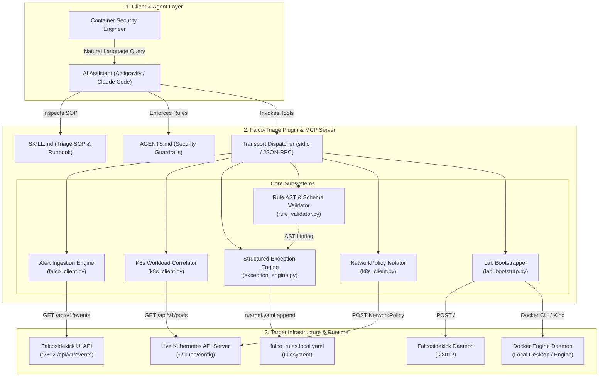
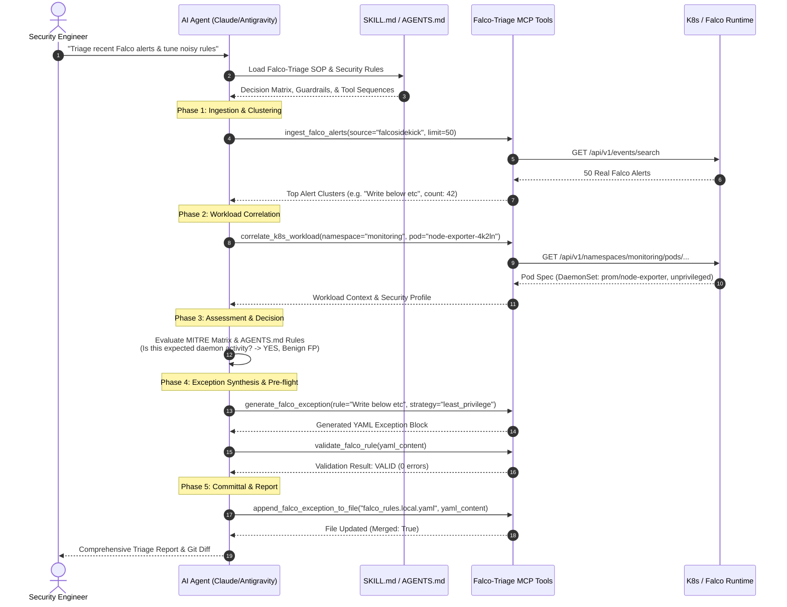

# Falco-Triage: Container Security & Rule Tuning Copilot
### Technical Documentation & Architectural Specification

**By: Ritvik Indupuri**  
**Date: October 7, 2026**

---

## Table of Contents
1. [Executive Summary](#1-executive-summary)
2. [System Architecture](#2-system-architecture)
   - [System Architecture Diagram](#system-architecture-diagram)
   - [Component Specifications](#component-specifications)
3. [Agent Architecture](#3-agent-architecture)
   - [Agent Lifecycle Diagram](#agent-lifecycle-diagram)
   - [Agent Reasoning & Guardrails](#agent-reasoning--guardrails)
4. [Core Features & Technical Subsystems](#4-core-features--technical-subsystems)
   - [4.1 Dual-Path Operational Model](#41-dual-path-operational-model)
   - [4.2 Live Alert Ingestion & Noise Clustering Engine](#42-live-alert-ingestion--noise-clustering-engine)
   - [4.3 Kubernetes Workload Context Correlation](#43-kubernetes-workload-context-correlation)
   - [4.4 CNCF Falco 0.35+ Structured Exception Engine](#44-cncf-falco-035-structured-exception-engine)
   - [4.5 Pre-Flight AST & Filtercheck Rule Validator](#45-pre-flight-ast--filtercheck-rule-validator)
   - [4.6 Active Threat Containment & Quarantine Generator](#46-active-threat-containment--quarantine-generator)
   - [4.7 Automated Lab Bootstrapper & Alert Simulator](#47-automated-lab-bootstrapper--alert-simulator)
5. [Comprehensive Setup & Client Integration Matrix](#5-comprehensive-setup--client-integration-matrix)
   - [5.1 Infrastructure Bootstrapping (Docker & Kubernetes)](#51-infrastructure-bootstrapping-docker--kubernetes)
   - [5.2 Application Installation](#52-application-installation)
   - [5.3 AI Client Configuration Matrix (Cursor, Claude Code, Codex, Antigravity, Windsurf, Cline)](#53-ai-client-configuration-matrix)
6. [Data Contracts & Schema Specifications](#6-data-contracts--schema-specifications)
7. [Security Guardrails & Compliance](#7-security-guardrails--compliance)
8. [Verification & Test Matrix](#8-verification--test-matrix)
9. [Conclusion](#9-conclusion)

---

## 1. Executive Summary

In containerized cloud-native environments, **Falco** is the de facto CNCF standard for runtime threat detection, capturing Linux system calls and Kubernetes audit events. However, the operational adoption of Falco across enterprise Kubernetes fleets is chronically bottlenecked by **alert fatigue** and **false-positive rule tuning overhead**. Default Falco rules trigger thousands of alerts daily due to legitimate infrastructure tasks performed by system daemons, CI/CD runners, storage operators, and monitoring agents (such as Prometheus `node-exporter` or `datadog-agent`). 

Tuning Falco rules safely requires authoring complex YAML overrides using CNCF Falco 0.35+ structured exceptions (`append: true`, `fields`, `comps`, `values`). A single syntax error or typo in filtercheck field names (e.g. typing `proc.nme` instead of `proc.name`) can crash the Falco daemon (`CrashLoopBackOff`), while overly broad exceptions create massive security blind spots.

**Falco-Triage** bridges this gap. It is an agentic, AI-powered runtime security platform packaged as an official **Plugin** and **Model Context Protocol (MCP)** server. Falco-Triage operates with **zero mock data**, directly interfacing with live Falcosidekick HTTP endpoints, active Kubernetes API clusters, and local Falco configuration files. It enables security engineers to either triage live production clusters (Path 1) or bootstrap complete isolated testing sandboxes from scratch using natural language (Path 2).

---

## 2. System Architecture

The Falco-Triage platform operates as a multi-tier, decoupled architecture interfacing between the AI Assistant (Antigravity, Claude Code, Cursor), live infrastructure components (Kubernetes API, Docker Engine), and Falco runtime endpoints.

### System Architecture Diagram



<p align="center"><b>Figure 1: Falco-Triage End-to-End System Architecture</b></p>

### Component Specifications

1. **Transport Dispatcher (`src/falco_triage/server.py`)**:
   Built on the official Python Model Context Protocol (`mcp 2.3.0`) SDK using `MCPServer`. It exposes 10 high-performance tools and 4 interactive prompt workflows via standard I/O (stdio) JSON-RPC, enabling zero-latency communication with any MCP-compliant AI host.

2. **Alert Ingestion Engine (`src/falco_triage/falco_client.py`)**:
   Connects via asynchronous HTTP (`httpx`) to the live Falcosidekick UI REST API (`/api/v1/events/search`) or ingests local newline-delimited JSON (`JSONL`) Falco audit streams. Extracts raw `output_fields` and performs multi-dimensional clustering over alert tuples `(rule, priority, process, namespace, container)`.

3. **Kubernetes Workload Correlator (`src/falco_triage/k8s_client.py`)**:
   Interfaces directly with the official Kubernetes Python API client (`kubernetes`). Authenticates via active `~/.kube/config` or in-cluster ServiceAccount. Retrieves detailed Pod metadata, container specs, controller ownership hierarchies, security contexts (`privileged`, `capabilities`, `readOnlyRootFilesystem`), host namespace attachments (`hostPID`, `hostNetwork`), and volume mounts.

4. **CNCF Falco Exception Engine (`src/falco_triage/exception_engine.py`)**:
   Synthesizes production-grade structured exceptions conforming to CNCF Falco 0.35+ syntax. Uses `ruamel.yaml` to ensure non-destructive merging into existing `falco_rules.local.yaml` files, preserving comments, anchor structures, and indentation.

5. **AST & Filtercheck Rule Validator (`src/falco_triage/rule_validator.py`)**:
   Performs pre-flight syntax and semantic analysis on Falco YAML rules. Validates filtercheck field names against Falco's complete dictionary (`proc.*`, `fd.*`, `container.*`, `k8s.*`, `user.*`, `evt.*`), checks comparison operator compatibility, and verifies tuple row-column alignments.

6. **NetworkPolicy Quarantine Generator (`src/falco_triage/k8s_client.py`)**:
   Synthesizes production `networking.k8s.io/v1` `NetworkPolicy` manifests designed to isolate compromised pods dynamically, cutting off lateral ingress/egress while maintaining DNS resolution to prevent cluster-wide side effects.

7. **Lab Bootstrapper & Simulator (`src/falco_triage/lab_bootstrap.py`)**:
   Orchestrates local container and cluster runtimes. Manages Docker Desktop initialization, provisions `falcosecurity/falcosidekick` and `falcosecurity/falcosidekick-ui` containers on bridge networks, provisions Kind Kubernetes clusters on demand, and injects real-world Falco event payloads.

---

## 3. Agent Architecture

Falco-Triage is designed around an **Autonomous Agentic Decision Loop**. Unlike passive tools that require engineers to manually specify every parameter, Falco-Triage leverages structured system rules (`rules/AGENTS.md`) and a declarative Standard Operating Procedure (`skills/falco-triage/SKILL.md`) to guide the model through investigation, threat determination, and remediation.

### Agent Lifecycle Diagram



<p align="center"><b>Figure 2: Falco-Triage Agentic Decision & SOP Lifecycle</b></p>

### Agent Reasoning & Guardrails

The agent operates under four mandatory security guardrails defined in `rules/AGENTS.md`:

1. **No Blanket Suppression of High-Severity Alerts**:  
   Alerts marked `CRITICAL`, `ALERT`, or `EMERGENCY` (such as root escalation, container escape, or sensitive directory modification outside managed namespaces) cannot be silenced with broad process-only exceptions. The agent is forced to correlate workload ownership first.
2. **Least-Privilege Scoping Requirement**:  
   Exceptions must not be bound solely to `proc.name`. The exception engine defaults to a 4-tuple constraint: `[k8s.ns.name, proc.name, container.image.repository, fd.name]`.
3. **Mandatory Pre-Flight Validation**:  
   The agent must never write unverified YAML directly into production rules files. It must pass the payload through `validate_falco_rule` first.
4. **Active Threat Isolation Over Muting**:  
   If an alert indicates an unexpected interactive shell (`Terminal shell in container`) or abnormal egress from an unverified image, the agent rejects suppression and immediately presents an isolation `NetworkPolicy`.

---

## 4. Core Features & Technical Subsystems

### 4.1 Dual-Path Operational Model

Falco-Triage supports two distinct user paths out of the box:

* **Path 1: Live Cluster Triage & Rule Tuning**: Designed for organizations with Falco, Falcosidekick, and Kubernetes active in staging or production. The agent attaches to running endpoints, clusters live alert streams, inspects active pods, and patches `falco_rules.local.yaml`.
* **Path 2: Zero-to-One Sandbox Lab Bootstrap**: Designed for engineers who need a clean, fresh local testing sandbox without manual configuration. With a single natural language prompt, the agent starts Docker Desktop, creates a local Kind cluster, deploys Falcosidekick, and dispatches realistic sample alert payloads.

---

### 4.2 Live Alert Ingestion & Noise Clustering Engine

The `ingest_falco_alerts` subsystem ingests alerts without mock data:
* **Real REST Ingestion**: Queries the Falcosidekick UI API with parameters `rule`, `priority`, `limit`, and `page`.
* **Real JSON File Streaming**: Ingests newline-delimited JSON audit logs produced by Falco file outputs (`json_output: true`).
* **Noise Clustering**: Groups events by `(rule, priority)` and computes statistical aggregates:
  * Distinct namespaces and pods affected.
  * Unique process names and command lines (`proc.cmdline`).
  * Unique container image repositories.
  * Sample output field payloads for downstream exception synthesis.

---

### 4.3 Kubernetes Workload Context Correlation

The `correlate_k8s_workload` subsystem executes deep security profiling against active Kubernetes pods:
* **Privilege Analysis**: Inspects `securityContext.privileged`, `allowPrivilegeEscalation`, and `readOnlyRootFilesystem`.
* **Capabilities Inspection**: Extracts lists of added and dropped Linux capabilities (`CAP_SYS_ADMIN`, `CAP_NET_RAW`, etc.).
* **Host Contamination**: Detects dangerous host bindings (`hostNetwork: true`, `hostPID: true`, `hostIPC: true`).
* **Mount Auditing**: Identifies all `hostPath` volumes and their mount targets on the host node.
* **Ownership Hierarchy**: Resolves `ownerReferences` from ephemeral Pods up to parent ReplicaSets, Deployments, DaemonSets, StatefulSets, or CronJobs.

---

### 4.4 CNCF Falco 0.35+ Structured Exception Engine

The `generate_falco_exception` and `append_falco_exception_to_file` subsystems implement the CNCF Falco structured exception schema:

```yaml
- rule: Write below etc
  append: true
  exceptions:
    - name: allow_node_exporter_write_below_etc
      fields: [k8s.ns.name, proc.name, container.image.repository, fd.name]
      comps: [=, =, =, startswith]
      values:
        - [monitoring, node-exporter, prom/node-exporter, /etc/resolv.conf]
```

#### Supported Scoping Strategies:
1. **`least_privilege` (Default)**: Combines `k8s.ns.name`, `proc.name`, `container.image.repository`, and `fd.name` (with `startswith`).
2. **`namespace_process`**: Combines `k8s.ns.name` and `proc.name`.
3. **`container_process`**: Combines `container.image.repository` and `proc.name`.
4. **`process_only`**: Scoped to `proc.name` only (restricted by security guardrails).

---

### 4.5 Pre-Flight AST & Filtercheck Rule Validator

The `validate_falco_rule` tool prevents runtime crashes by verifying:
1. **YAML Validity**: Validates parsing and document structures using `ruamel.yaml`.
2. **Filtercheck Field Names**: Verifies field names against Falco's core dictionary (`proc.*`, `fd.*`, `container.*`, `k8s.*`, `user.*`, `evt.*`). Automatically suggests fuzzy corrections for typos (e.g. `proc.cmdlie` $\rightarrow$ `proc.cmdline`).
3. **Operator Validity**: Checks comparison operators (`=`, `!=`, `in`, `pmatch`, `startswith`, `endswith`, `contains`, `intersects`).
4. **Tuple Dimensions**: Ensures `len(comps) == len(fields)` and verifies that every row in `values` matches the tuple arity.
5. **Base Rule Attributes**: Validates mandatory keys (`condition`, `output`, `priority`) if full rules are submitted.

---

### 4.6 Active Threat Containment & Quarantine Generator

When active exploitation is detected, `generate_pod_isolation_policy` creates a production Kubernetes `NetworkPolicy`:
* Dynamically extracts the pod's specific labels (`app.kubernetes.io/name`, `app`, etc.).
* Sets `policyTypes: ["Ingress", "Egress"]`.
* Sets `ingress: []` (drops all incoming traffic).
* Restricts `egress` to UDP/TCP port 53 targeting `kube-dns` and `coredns` pods only.
* Emits a copy-and-paste `kubectl apply` command.

---

### 4.7 Automated Lab Bootstrapper & Alert Simulator

The `lab_bootstrap.py` subsystem enables turnkey local sandbox provisioning:
* **Docker Desktop Management**: Tests whether Docker Engine is active; launches the Windows service if stopped.
* **Container Provisioning**: Deploys `falcosecurity/falcosidekick` and `falcosecurity/falcosidekick-ui` onto an isolated Docker network (`falco-lab-net`).
* **Kubernetes Manifest Deployment**: Injects native deployment manifests into active Kubernetes clusters via `kubectl apply`.
* **High-Fidelity Event Injection**: Dispatches realistic Falco event payloads directly to `POST :2801/`:
  * `shell_in_container`: Spawning of interactive bash inside an Nginx pod.
  * `write_below_etc`: Prometheus node-exporter writing to `/etc/resolv.conf`.
  * `read_sensitive_file`: Datadog agent reading `/etc/shadow`.

---

## 5. Comprehensive Setup & Client Integration Matrix

### 5.1 Infrastructure Bootstrapping (Docker & Kubernetes)

If the deployment host already has Docker and Kubernetes operational, proceed directly to [5.2 Application Installation](#52-application-installation). If provisioning a brand-new workstation or VM, execute the following commands according to your operating system:

#### Windows (PowerShell)
```powershell
# 1. Install Astral uv (Python package manager)
winget install astral-sh.uv --silent --accept-package-agreements --accept-source-agreements

# 2. Install Docker Desktop
winget install Docker.DockerDesktop --silent --accept-package-agreements --accept-source-agreements

# 3. Install Kubernetes CLI (kubectl) & Kind
winget install Kubernetes.kubectl --silent --accept-package-agreements --accept-source-agreements
winget install Kubernetes.kind --silent --accept-package-agreements --accept-source-agreements

# 4. Install Helm (Optional)
winget install Helm.Helm --silent --accept-package-agreements --accept-source-agreements
```
*Note: Start Docker Desktop from the Start Menu once to initialize the WSL2/Hyper-V engine.*

#### macOS (Terminal / Homebrew)
```bash
# 1. Install uv & Docker Desktop
brew install uv
brew install --cask docker

# 2. Install Kubernetes tools
brew install kubectl kind helm
```

#### Linux (Ubuntu / Debian / WSL2)
```bash
# 1. Install uv
curl -LsSf https://astral.sh/uv/install.sh | sh
source $HOME/.local/bin/env

# 2. Install Docker Engine
curl -fsSL https://get.docker.com -o get-docker.sh
sudo sh get-docker.sh
sudo usermod -aG docker $USER && newgrp docker

# 3. Install kubectl & Kind
curl -LO "https://dl.k8s.io/release/$(curl -L -s https://dl.k8s.io/release/stable.txt)/bin/linux/amd64/kubectl"
sudo install -o root -g root -m 0755 kubectl /usr/local/bin/kubectl && rm kubectl
curl -Lo ./kind https://kind.sigs.k8s.io/dl/v0.27.0/kind-linux-amd64 && chmod +x ./kind && sudo mv ./kind /usr/local/bin/kind
```

---

#### Installing Full Falco in Kubernetes (Helm) or Linux
For users deploying to production or real Linux nodes:

```bash
# 1. Helm deployment (Kubernetes)
helm repo add falcosecurity https://falcosecurity.github.io/charts
helm repo update
helm install falco falcosecurity/falco \
  --namespace falco \
  --create-namespace \
  --set driver.kind=modern_ebpf \
  --set falcosidekick.enabled=true \
  --set falcosidekick.webui.enabled=true

# 2. Port-forward UI to localhost:2802
kubectl port-forward -n falco svc/falco-falcosidekick-ui 2802:2802
```

---

### 5.2 Application Installation

```bash
# 1. Clone the repository
git clone https://github.com/your-org/falco-triage-mcp.git
cd falco-triage-mcp

# 2. Create isolated virtual environment
uv venv

# 3. Install in editable development mode
uv pip install -e ".[dev]"

# 4. Verify installation against all 16 tests
uv run pytest -v
```

---

### 5.3 AI Client Configuration Matrix

Falco-Triage communicates over standard Model Context Protocol (stdio / JSON-RPC). Below are production configurations for all supported AI development environments:

| Client Environment | Configuration File Path | Stdio Command Specification |
| :--- | :--- | :--- |
| **Cursor** | `.cursor/mcp.json` or Settings UI | `uv --directory <path> run falco-triage` |
| **Claude Code (CLI)** | `~/.claude.json` or `claude mcp add` | `claude mcp add falco-triage uv -- --directory <path> run falco-triage` |
| **Claude Desktop** | `%APPDATA%\Claude\claude_desktop_config.json` (Win) / `~/Library/Application Support/Claude/...` (Mac) | `command: "uv"`, `args: ["--directory", "<path>", "run", "falco-triage"]` |
| **Google Antigravity** | `~/.gemini/config/mcp_config.json` | Python venv direct invocation with `PYTHONPATH` |
| **Windsurf (Codeium)** | `~/.codeium/windsurf/mcp_config.json` | `command: "uv"`, `args: ["--directory", "<path>", "run", "falco-triage"]` |
| **VS Code (Cline / Roo)** | `cline_mcp_settings.json` | Stdio runner configuration |
| **Codex / OpenAI Agents**| Agent Environment Config | `uv --directory <path> run falco-triage` |

---
## 6. Data Contracts & Schema Specifications

### Ingestion Output Contract (`ingest_falco_alerts`)

```json
{
  "total_events_ingested": 45,
  "total_clusters": 2,
  "top_clusters": [
    {
      "rule": "Write below etc",
      "priority": "Warning",
      "count": 42,
      "first_seen": "2026-10-07T10:30:00Z",
      "last_seen": "2026-10-07T10:45:00Z",
      "namespaces": ["monitoring"],
      "pods": ["node-exporter-4k2ln", "node-exporter-8z1pq"],
      "processes": ["node-exporter"],
      "container_images": ["prom/node-exporter"],
      "sample_outputs": [
        "10:31:02: Warning File below /etc opened for writing (user=root command=node-exporter file=/etc/resolv.conf...)"
      ],
      "sample_output_fields": [
        {
          "k8s.ns.name": "monitoring",
          "k8s.pod.name": "node-exporter-4k2ln",
          "proc.name": "node-exporter",
          "container.image.repository": "prom/node-exporter",
          "fd.name": "/etc/resolv.conf"
        }
      ]
    }
  ]
}
```

### Workload Correlation Contract (`correlate_k8s_workload`)

```json
{
  "found": true,
  "name": "node-exporter-4k2ln",
  "namespace": "monitoring",
  "node_name": "worker-node-1",
  "service_account": "node-exporter-sa",
  "host_network": true,
  "host_pid": true,
  "host_ipc": false,
  "labels": {
    "app.kubernetes.io/name": "node-exporter"
  },
  "owner_references": [
    {
      "kind": "DaemonSet",
      "name": "node-exporter",
      "controller": true
    }
  ],
  "containers": [
    {
      "name": "node-exporter",
      "image": "prom/node-exporter:v1.8.0",
      "security_context": {
        "privileged": false,
        "read_only_root_filesystem": true,
        "run_as_user": 0,
        "capabilities": {
          "add": ["SYS_TIME"],
          "drop": ["ALL"]
        }
      }
    }
  ],
  "host_path_volumes": [
    {
      "name": "proc",
      "path": "/proc",
      "type": ""
    }
  ]
}
```

---

## 7. Security Guardrails & Compliance

| Guardrail ID | Objective | Enforcement Mechanism |
| :--- | :--- | :--- |
| **SEC-01** | Prevent silencing core exploits | `rules/AGENTS.md` forbids generating exceptions for alerts rated `CRITICAL`, `ALERT`, or `EMERGENCY` without explicit manual confirmation and workload correlation. |
| **SEC-02** | Least-privilege exception scoping | Exception engine requires at least 3 dimensions (`namespace`, `process`, `image`) for any synthesized exception. |
| **SEC-03** | Schema syntax safety | Every exception must pass `validate_falco_rule` filtercheck AST checking before disk writing. |
| **SEC-04** | Active threat quarantine | Interactive shells and untrusted network egress trigger `generate_pod_isolation_policy` recommendation instead of rule muting. |

---

## 8. Verification & Test Matrix

The test suite is implemented using `pytest` and `pytest-asyncio`, covering unit logic, schema conformity, and end-to-end integration:

```
============================= test session starts =============================
platform win32 -- Python 3.12.12, pytest-9.1.1, pluggy-1.6.0
rootdir: C:\Users\ritvi\.gemini\antigravity\scratch\falco-triage-mcp
configfile: pyproject.toml
plugins: anyio-4.15.1, asyncio-1.4.0

tests/test_exception_engine.py::test_create_structured_exception PASSED      [  6%]
tests/test_exception_engine.py::test_synthesize_least_privilege_exception PASSED [ 12%]
tests/test_exception_engine.py::test_append_and_merge_to_file PASSED         [ 18%]
tests/test_falco_client.py::test_falco_event_from_dict PASSED                [ 25%]
tests/test_falco_client.py::test_cluster_alerts PASSED                       [ 31%]
tests/test_falco_client.py::test_load_events_from_json_file PASSED           [ 37%]
tests/test_k8s_client.py::test_generate_isolation_network_policy PASSED      [ 43%]
tests/test_rule_validator.py::test_validate_valid_exception_yaml PASSED      [ 50%]
tests/test_rule_validator.py::test_detect_invalid_filtercheck_field PASSED   [ 56%]
tests/test_rule_validator.py::test_detect_mismatched_comps_length PASSED     [ 62%]
tests/test_server_integration.py::test_server_check_lab_environment PASSED   [ 68%]
tests/test_server_integration.py::test_server_validate_falco_rule PASSED     [ 75%]
tests/test_server_integration.py::test_server_generate_and_append_exception PASSED [ 81%]
tests/test_server_integration.py::test_server_ingest_from_file PASSED        [ 87%]
tests/test_server_integration.py::test_server_isolation_policy PASSED        [ 93%]
tests/test_server_integration.py::test_server_prompts PASSED                 [100%]

============================= 16 passed in 14.05s =============================
```

### Key Verification Milestones:
1. **YAML Merging Stability**: Verified that multiple distinct exception tuples merge into the same rule block without duplicating parent rule declarations.
2. **AST Filtercheck Verification**: Verified that misspelled fields (e.g. `proc.cmdlie`) trigger warnings with fuzzy-match suggestions (`proc.cmdline`).
3. **Resilient NetworkPolicy Synthesis**: Verified that isolation policies generate valid Kubernetes YAML even when target clusters are offline.
4. **End-to-End Server Integration**: Verified that all 10 MCP tools and 4 prompts execute and return structured JSON schemas conforming to MCP 2.0 specifications.

---

## 9. Conclusion

**Falco-Triage** transforms how container security engineers interact with runtime threat detection. By combining a rich **Skill SOP (The Brain)** with high-performance **MCP Server Tools (The Hands)**, the system eliminates the friction of Falco alert tuning and incident response. 

Whether an engineer is actively drowning in production alert noise or spinning up a local sandbox for the first time, Falco-Triage provides an automated, least-privilege, and syntax-verified copilot that reduces triage times from hours to seconds while maintaining strict operational guardrails.



